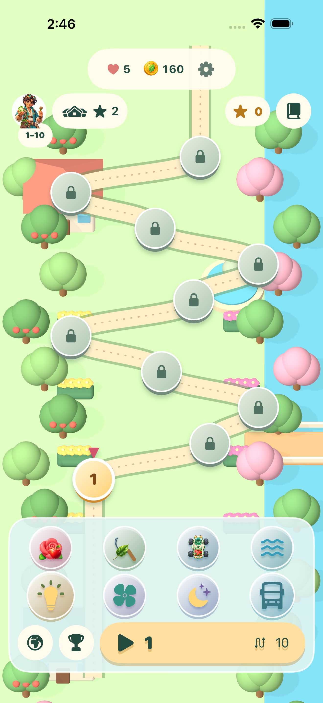
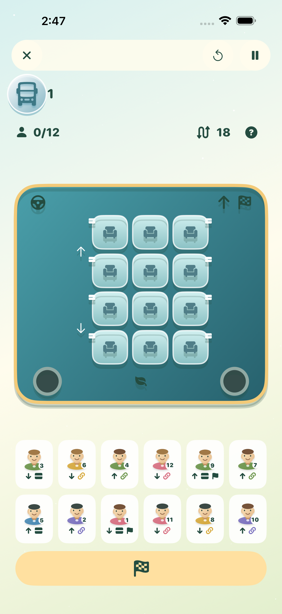
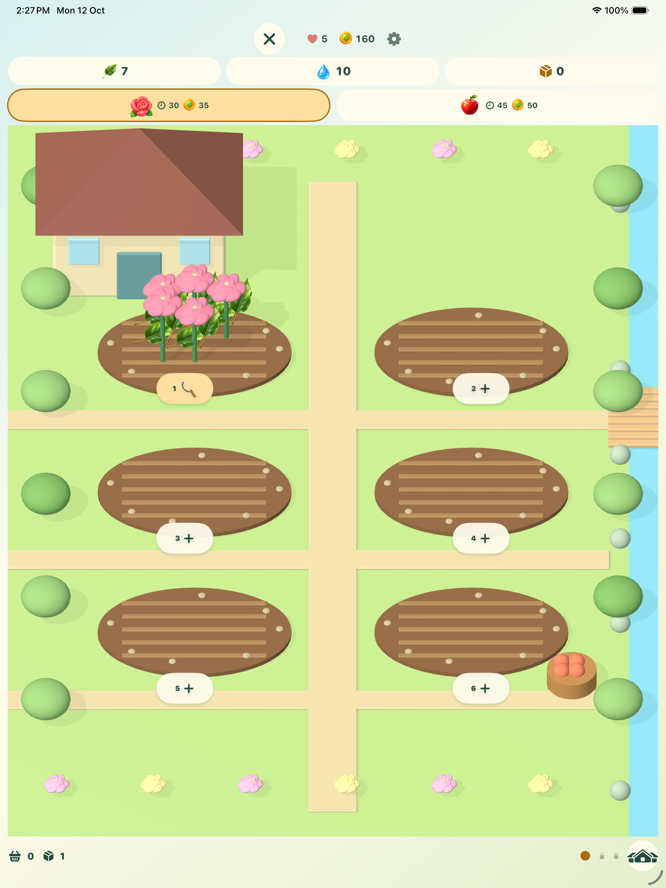

# Orbit Bloom 1.0 (17)

Build 17 is implemented, played, tested, signed and installed over the personal preview save. Source is `a5a2dbc57fecbf6b7524de2dea7d6f26417a1773`. [Gameplay and UX](../../BUILD17_GAMEPLAY_AND_UX.md) explains the eight direct icons, layered hard puzzles, three farm fields, updated Rally, win kit and new two-deck seating game. [Original apple prompt](../../BUILD17_ARTWORK_PROMPT.md) records its unchanged generated PNG.

**Build 17 is not uploaded or submitted.** The fresh Xcode upload attempt reports `Failed to Use Accounts`. Transporter was initially signed in, but native computer control became unavailable and reconnect failed. No account credentials were extracted or new agreement accepted. The signed [package verification](signed-package-verification.json) pins the IPA, Production Game Center/private iCloud, disabled debugger and absent test plug-ins. Package: `build/AppStoreExport17/OrbitBloom.ipa`.

Chrome rechecked Apple's [current submission](https://appstoreconnect.apple.com/apps/6820591529/distribution/reviewsubmissions/details/83b00d39-0873-4771-8bc9-5d94d4be04b4): **build 11**, Atoll Skills and all six purchase packs remain **Waiting for Review**, with manual public release. [Actual status proof](proof/apple-existing-review.jpg) and [status record](apple-review-status.json) distinguish that submission from local build 17. Its existing metadata and galleries were left intact. Apple has not approved these eight items.

The [verification record](verification.json) covers **134 unique passing cases**: 60 core, 59 native, fourteen phone UI and one iPad tour. All 1,020 campaign stages were completed with legal input and earned bursts, without paid items or extra moves. All 1,000 shuttle layouts have valid plans. UI play includes all five skill wins, complete Rally steering, three independently saved fields, offline growth/harvest, the three-power start cap, correct life costs and both iPad orientations. Failed/interrupted diagnostics remain private in `evidence`; corrections and incomplete result detail are described in the record rather than counted as passes.

The latest ordinary preview has **555 coins, three completed levels, six hints, five lives and the active level 4 rules-2 board with nine moves**. [Full preservation proof](preview-preservation.json) checks every old wallet value and board identity, normalizes only unordered enum-dictionary encoding, and permits only empty new defaults. Installation itself left preferences identical. Full before/after containers remain private in `build`. The old active board keeps its original rules; new attempts use the harder campaign.

[Screenshot provenance](manifest.json) retains original device/build/test names and SHA-256 hashes, with no edits or resizing. [Prepared Apple galleries](apple-gallery-prepared.json) select ten phone and ten iPad images. [Prepared copy and What to Test](metadata-prepared.json) fit Apple's field limits and are local only. Native images illustrate the actual interface; they are separate from generated art.

The isolated [Cloudflare game site](https://orbit-bloom-game-site.ajnasnb.workers.dev/) now describes the eight-activity development build and shows a native build-17 puzzle. [Deployment record](site-delivery.json) and [Chrome proof](proof/cloudflare-site.jpg) identify version `651367f7-33c3-4d47-9a9e-f4b293dcb802`; five HTTPS/security routes pass. Existing unrelated projects and DNS were not changed. No player-save or payment database was added.

To finish the Apple handoff, use the existing signed IPA with a working Xcode/Transporter account, verify/deliver it, wait for processing, assign Orbit Bloom QA, then replace the build and matching galleries and submit the eight review items. Keep release manual. Physical Game Center, cross-device private iCloud and signed sandbox purchases still need a device check; simulator doubles establish app-side behavior only. No real purchase was performed.
